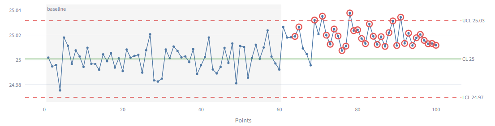

# SPC Control Chart Tool

A statistical process control (SPC) web app in Python. Load measurement data, and it
builds control charts, flags out-of-control signals using the Western Electric rules,
and calculates process capability.

   **[▶ Try it live](https://seanlee-spc.streamlit.app)**

   

All data in this repo is synthetic, generated by `generate_data.py` with known problems
planted in it (shifts, drift, outliers) so you can see the tool catch them.

## Features

- **I-MR charts** for individual measurements and **X̄-R charts** for subgroups (n = 2–10)
- **Phase I baseline:** calculate limits from a known-good period, then judge new data against them
- **Western Electric rules 1–4,** with out-of-control points circled on the chart
- **Capability:** Cp, Cpk (within-subgroup sigma) and Pp, Ppk (overall sigma), with a
  histogram against spec limits, and a warning when Ppk falls well below Cpk
- **Upload your own CSV** or use the built-in sample datasets
- **Unit tests** with hand-calculated expected values for every calculation

## Setup

Requires Python 3.10+.

```
pip install -r requirements.txt
python generate_data.py
streamlit run app.py
```

The app opens in your browser at http://localhost:8501.

## Running the tests

```
python -m pytest -v
```

## Sample datasets

Use spec limits **LSL 24.95**, **USL 25.05** for all of them.

| File | What's planted | Suggested settings |
|---|---|---|
| `stable.csv` | Nothing: an in-control process | I-MR, all points |
| `mean_shift.csv` | +2σ shift at point 61 | I-MR, baseline 60 |
| `tool_wear_drift.csv` | Gradual upward drift | I-MR, baseline 30 |
| `single_outlier.csv` | One 5σ outlier at point 46 | I-MR, all points |
| `subgroups_n5.csv` | Shift at subgroup 18 | X̄-R, n = 5, baseline 17 |

## Project layout

```
spc/constants.py    Control chart constants (A2, D3, D4, d2) for n = 2-10
spc/charts.py       Control limits for I-MR and X̄-R charts
spc/rules.py        Western Electric rules 1-4
spc/capability.py   Cp, Cpk, Pp, Ppk
app.py              Streamlit user interface
generate_data.py    Creates the synthetic sample data
tests/test_spc.py   Unit tests
```

## Status

- [x] I-MR limits
- [x] Rule 1
- [x] Pp / Ppk
- [x] X̄-R limits
- [x] Rules 2, 3, 4
- [x] Cp / Cpk
